<!-- Custom animated banner → https://github.com/MohammedQuraan24/MohammedQuraan24/blob/main/assets/banner.svg -->

---

## 👋 Hey, I'm Mohammed!

I'm a developer who fell in love with **making things work**. I started with the fundamentals — **C** and **C++** — then kept going: **Java**, **Python**, **JavaScript**, **CSS**, and of course **Git & GitHub**.

I'm not done learning. I'm the kind of person who opens a terminal, tries something new, breaks it, fixes it, and commits it. Every day is a small step toward building something genuinely useful.

> 💬 *"The best way to learn is to build. The best way to build is to start."*

### 🧠 Currently

---

## 🛠️ My toolkit

| Language / Tool | What I use it for |
| :--- | :--- |
| **C** | Understanding how things really work under the hood — memory, pointers, logic. |
| **C++** | Object-oriented thinking, data structures, and problem solving. |
| **Java** | Building structured, reliable applications. |
| **Python** | Automation, scripts, data work, and quick ideas. |
| **JavaScript** | Bringing pages to life with interactivity. |
| **CSS** | Turning rough layouts into something that actually looks good. |
| **Git & GitHub** | Version control, collaboration, and showing up every day. |

---

## 📊 A few numbers

---

## 🐍 My commits, as a snake

Every square is a day. The snake eats my contribution history. It updates automatically every day via GitHub Actions.

🐍 Powered by [Platane/snk](https://github.com/Platane/snk) — the `output` branch is refreshed daily.

---

## 🎯 What's next

- [ ] Finish a real project in **C++** and ship it
- [ ] Build a **Python** tool I actually use myself
- [ ] Create a full **JavaScript + CSS** portfolio site
- [ ] Contribute to an open-source repo (first PR is the goal!)
- [ ] Keep the streak alive 🔥

---

## 📫 Let's connect

📧 **[mohammadhjdke@gmail.com](mailto:mohammadhjdke@gmail.com)**

Feel free to fork this profile, star a repo, or just say hi. I'm always happy to talk code, projects, or what to learn next.

---

**Thanks for stopping by!** ✨

Built with curiosity, caffeine, and a lot of `git commit -m "fix"`.

